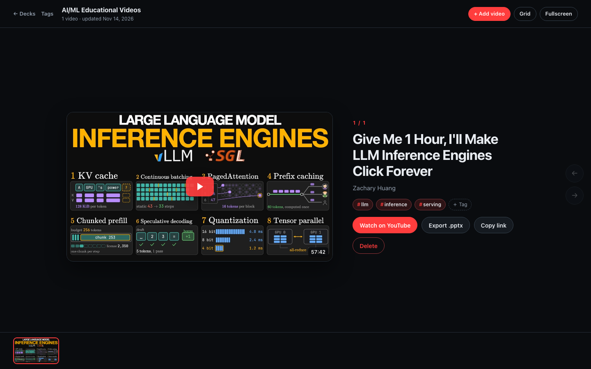

# YouTube Slide Decks

A public collection of YouTube videos arranged as slide decks. Each slide is a video thumbnail with
its title, channel, duration and a link back to YouTube. A static viewer steps through a deck, and an
**Export .pptx** button in the viewer downloads a PowerPoint file that Google Slides can import.

Live site: **https://somphol.github.io/youtube-slide-decks/**



This is a reference library, not a video host. Nothing downloads video.

## Viewer

- Arrow keys, space, Home/End, `g` for the grid, `f` for fullscreen, `Esc` to close the grid.
- Swipe left/right on touch devices.
- Deep links: `?deck=ai-ml-educational-videos&slide=3`.
- Dark and light themes follow the system setting.
- **Export .pptx** downloads the current deck; import it with Google Drive → Open with → Google Slides.

## Add a video

```sh
node scripts/deck.mjs add "AI/ML Educational Video Slide deck" \
  "https://www.youtube.com/watch?v=I2QhfZ0aVmk" --create
```

Or ask OpenCode: *“Put this https://youtu.be/… into AI/ML Educational Video Slide deck.”* The
`youtube-slide-decks` skill in `skills/` handles the lookup, thumbnail, metadata and reporting.

## Commands

| Command | Purpose |
| --- | --- |
| `node scripts/deck.mjs list [--json]` | decks, ids, slide counts |
| `node scripts/deck.mjs create "Title" [--description "..."]` | new empty deck |
| `node scripts/deck.mjs add "Deck" <url...> [--create] [--note "..."] [--force] [--hotlink]` | add videos |
| `node scripts/deck.mjs remove "Deck" <video-id\|url\|index>` | drop a slide |
| `node scripts/deck.mjs move "Deck" <video-id\|index> <position>` | reorder |
| `node scripts/deck.mjs rename "Deck" "New title"` | rename |
| `node scripts/deck.mjs delete "Deck" --yes` | delete a deck |
| `node scripts/deck.mjs export ["Deck" \| --all] [--out DIR]` | write `.pptx` from the CLI |
| `node scripts/deck.mjs rebuild` | regenerate `decks/index.json` |
| `node scripts/deck.mjs verify [--remote]` | validate everything |
| `node scripts/deck.mjs serve [--port 4173]` | local viewer |

Global flags: `--home <dir>` or `DECK_HOME`. Without either, the current directory is used when it
contains `decks/`, otherwise `~/Projects/youtube-slide-decks`.

## Export

**In the browser:** open a deck, press **Export .pptx**. The deck, thumbnails and metadata are packed
client-side; nothing is uploaded. The file is named `<deck-id>.pptx`.

**From the CLI:** `node scripts/deck.mjs export --all` writes the same format to `exports/`
(gitignored).

Each slide carries the thumbnail, title, channel, duration, the deck title as a kicker, and two
clickable paths to the video: the image and the “Watch on YouTube” line.

## Layout

```text
.
├── decks/
│   ├── index.json                  generated catalog
│   └── <deck-id>/
│       ├── deck.json               deck metadata and slides
│       └── thumbnails/<id>.jpg
├── index.html                      deck browser
├── deck.html                       slide viewer (?deck=<id>&slide=<n>)
├── assets/
│   ├── app.js                      viewer + browser export
│   └── pptx-core.mjs               shared OOXML/ZIP builder (no dependencies)
├── exports/                        CLI .pptx output, gitignored
├── scripts -> skills/youtube-slide-decks/scripts
└── skills/youtube-slide-decks/     the skill (SKILL.md, references, assets/site, scripts)
```

## Verification

```sh
node scripts/deck.mjs verify            # structure, catalog, exports
node scripts/deck.mjs verify --remote   # plus thumbnail HTTP checks
```

## Thumbnails and attribution

Thumbnails are uploaded by the channels that published the videos and remain their copyright. They
appear here for reference alongside a link to the original video. If a creator asks for removal, delete
the slide with `remove` or the deck with `delete --yes`. See [ATTRIBUTION.md](ATTRIBUTION.md).
